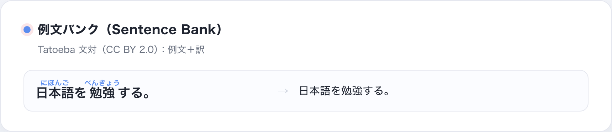

# Nihongo Core

**[English](README.md) · [简体中文](README.zh-CN.md) · [日本語](README.ja.md)**

日本語の読みと言語データ契約を提供する、再利用可能な Python ライブラリです。文脈読み、かな・ローマ字変換、翻訳検証、辞書読み込み、文法チェック、エクスポート用モデルを備えています。

歌詞検索サービス、エンドユーザー向けアプリ、Agent ワークフローではありません。検索方法、表示、翻訳サービス、ライセンス済みデータの選択は利用側が担当します。

## 機能と成熟度

| 分野 | 提供する機能 | 状態と制限 |
| --- | --- | --- |
| 読み | 文脈付きトークン、平仮名、ヘボン式、読みのアライメント、かな変換、活用形の復元・生成、文分割、モーラ数 | 公開 API で、アプリ利用者があります。テストは契約と原文保持を確認しますが、人手による読音精度は測定しません。 |
| 翻訳 | 行単位データモデル、検証器、言語レジストリ、用語チェック、任意の OpenAI 互換クライアント | 公開契約。構造検査だけでは意味品質を証明できません。モデルのエンドポイントとキーは利用側が用意します。 |
| 参照データ | Yomitan の語句・漢字、JMnedict の名前、アクセント、難易度、KanjiVG、Tatoeba 例文 | 読み込み機能とアダプターで、多くは実験段階です。データを用意し、それぞれのライセンスに従ってください。 |
| 組み合わせ | 助詞・パターン検出、Anki payload、対訳 Markdown、文マイニング契約 | 実験的な部品です。ユーザーフローとネットワーク処理はアプリ側の責任です。 |

大規模な辞書・例文データは同梱しません。評価の限界は[ベンチマークの説明](docs/benchmarks.md)、人手確認の進捗は[読音レビュー表](docs/reading-review-sheet.md)を参照してください。

## インストール

Python 3.10 以上。基本パッケージに実行時依存はありません。

| インストール | 内容 |
| --- | --- |
| <code>japanese-language-core[reading]</code> | 文脈読み用の SudachiPy と SudachiDict Core |
| <code>japanese-language-core[translation]</code> | 翻訳契約と検証器。標準ライブラリのみ |
| <code>japanese-language-core[all]</code> | 既定の読音依存 |
| <code>japanese-language-core[pykakasi]</code> | 任意の比較エンジン。Fugashi/PyKakasi の依存には GPL-3.0 を含む |

~~~bash
python3 -m venv .venv
source .venv/bin/activate

# 読音機能
python -m pip install "japanese-language-core[reading] @ git+https://github.com/qweihu/japanese-language-core.git@v0.4.0"

# 翻訳契約のみ
python -m pip install "japanese-language-core[translation] @ git+https://github.com/qweihu/japanese-language-core.git@v0.4.0"
~~~

開発用：

~~~bash
git clone https://github.com/qweihu/japanese-language-core.git
cd japanese-language-core
python3 -m pip install -e ".[reading]"
~~~

## クイックスタート：読み

~~~python
from japanese_language_core.reading import create_engine

engine = create_engine("auto")
tokens = tuple(engine.tokens("雨が降り止むまでは帰れない"))

for token in tokens:
    print(token.orig, token.hira, token.hepburn)

assert "".join(token.orig for token in tokens) == "雨が降り止むまでは帰れない"
~~~

各トークンは原文を保持したまま読みを追加します。例：<code>雨 → あめ</code>、
<code>降り止む → ふりやむ</code>、<code>帰れ → かえれ</code>。空白や改行も保持します。

 読みの例 · トークンを連結すると原文を復元できます。

## 読みの詳細

- <code>create_engine("auto")</code> は Sudachi を優先します。任意の PyKakasi 拡張がインストールされている場合だけ、そこへフォールバックします。どちらも利用できない場合はエラーになります。
- <code>ReadingToken.orig</code> を順につなぐと入力を完全に再構成できます。<code>hira</code> と <code>hepburn</code> は読みを保持し、Sudachi 経路では形態情報も利用できます。
- かな変換とヘボン式ローマ字変換は、読音追加依存なしで利用できます。

 かな変換 · 同じ入力に対する文字種とローマ字を表示。

 活用例 · 入力形を分析し、よく使う形を生成します。

人名、歌詞、方言、多義漢字の読みが常に正しいことを保証しません。現在のレビュー表は小規模な手順確認であり、精度スコアや人手評価済みベンチマークではありません。

## 翻訳契約

Core は翻訳モデルを内蔵しません。利用側が設定した OpenAI 互換エンドポイントに行単位のデータを送るか、Agent から同じ契約へ訳文を渡せます。

検証器が確認する項目：

- <code>paired=True</code> の場合、空でない行が一対一に対応していること；
- Ruby の構造と、タグを除いた原文の保持；
- <code>♪</code>、<code>[Chorus]</code>、括弧内メモなどの保持；
- 翻訳行に残った日本語の仮名；
- 任意の用語集との一貫性。

行数や構造の不一致はエラーです。翻訳行の仮名残りは通常は警告で、厳密モードでは非ゼロ終了コードになります。検証の成功は構造が契約に合うことを示すだけで、訳の正確さ、自然さ、歌詞への忠実さは証明しません。

 翻訳検証 · 構造を確認し、未翻訳の日本語を検出します。

任意クライアントを使う場合は、アプリ側からエンドポイント、モデル、キーを指定してください。Core は資格情報を提供せず、目標言語も決定しません。

## 参照データと実験的な機能

これらは再利用可能な部品で、完成済みの製品機能ではありません。データ取得、ライセンス、キャッシュ、UI、製品上の判断は利用側が担当します。

### 辞書・例文リーダー

Yomitan 辞書リーダーは読み、語義、タグ、頻度、アクセント、JLPT メタデータを扱えます。JMnedict は名前を検索し、KanjiVG リーダーは筆順データを読み込みます。例文リーダーは Tatoeba の対訳を扱います。データは別途用意し、CC BY 2.0 の条件に従ってください。

 辞書読み込み · 呼び出し側が渡すデータから項目を読みます。

 例文読み込み · 原文と提供された訳文を対応付けます。

### 文法とエクスポート

文法ヘルパーは助詞やパターンを決定的に検査しますが、完全な文法解析器ではありません。エクスポートモデルは Anki TSV、AnkiConnect payload、対訳 Markdown を作れますが、Anki へのネットワーク接続や学習者のカード管理は行いません。

 文法チェック · 指定したパターンを報告し、完全解析とは主張しません。

 エクスポートデータ · 呼び出し側に渡す具体的な行を表示。

## CLI

<code>nihongo</code> と <code>python -m japanese_language_core</code> は決定的な操作を提供します。翻訳検証と翻訳ヘルパーには独立したモジュール入口があります。

~~~bash
nihongo --help
python -m japanese_language_core.translation validate --source source.txt --translation translation.txt --paired
python -m japanese_language_core.translation languages
~~~

 CLI 出力 · 検証の成功状態と警告数を返します。

## 開発と評価

~~~bash
python3 -m pip install -e ".[all]"
python3 -m pytest -q
~~~

テストは API 契約、シリアライズ、原文保持、決定的な動作を確認します。読音精度や翻訳品質は測定しません。評価結果を公開する場合は、人手で確認したデータを使い、読音エンジンと辞書のバージョンを記録してください。

## ライセンス

MIT。任意の依存パッケージや外部データには別のライセンスが適用される場合があります。再配布前に個別に確認してください。
