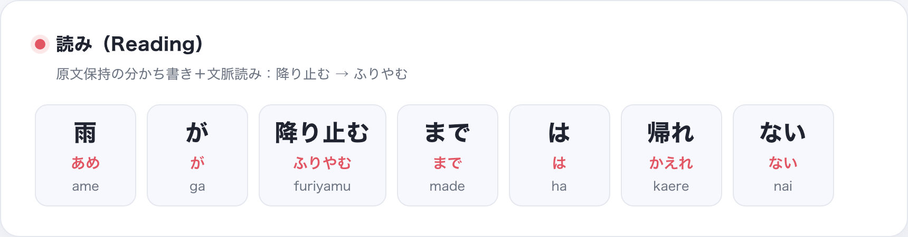
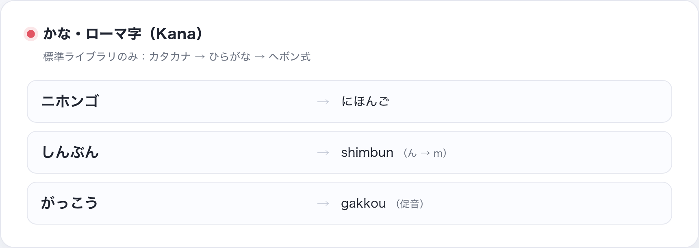
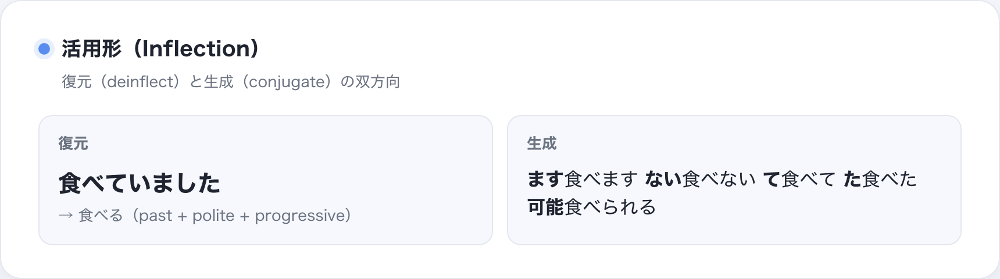
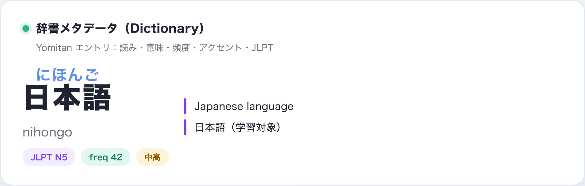
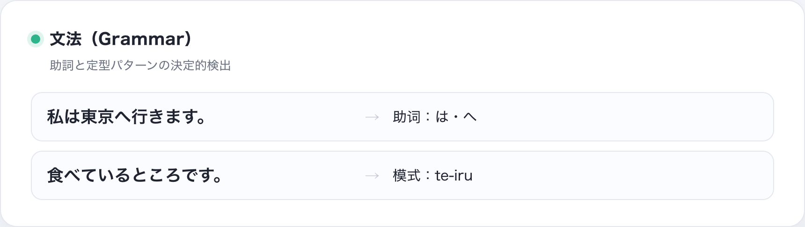
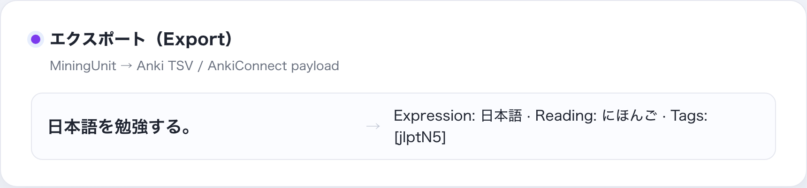
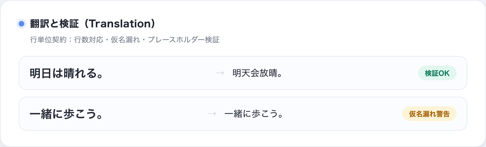
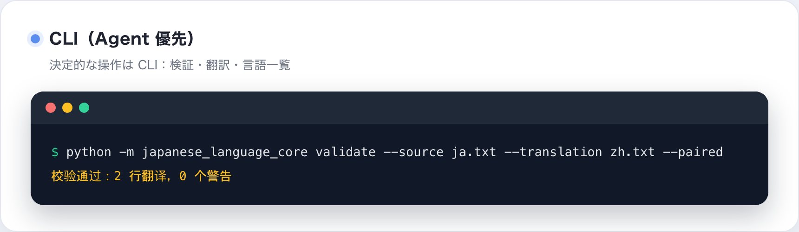
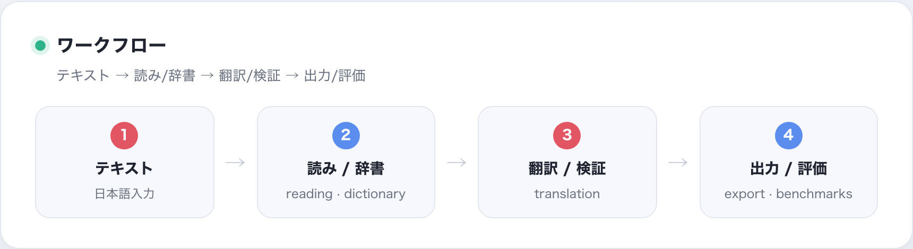

# Nihongo Core（japanese-language-core）

**[English](README.md) | [简体中文](README.zh-CN.md) | [日本語](README.ja.md)**

Nihongo Core は Python 向けのプロフェッショナルな日本語処理ライブラリです：
文脈付き読み、かな/ローマ字、読み-漢字アライメント、活用形復元、行単位翻訳
コントラクト、辞書メタデータ、文法パターン検出、エクスポート契約。

設計の柱：

- **決定的な契約**：読みトークン、翻訳ユニット、辞書エントリなどは小さく
  テスト可能でバージョン管理されたインターフェース。
- **依存は必要に応じて**：ベースは依存ゼロ。読みは形態素辞書が必要、
  翻訳は LLM 能力（エンドポイントはユーザーが用意）。

> **能力の成熟度**：`reading` と `translation` が本番コアです。
> `dictionary` / `grammar` / `export` は安定していますが実験的で、
> 組み込みの消費者はまだ依存していません。必要に応じて使ってください。

## 機能一覧

| モジュール | 名称 | 内容 |
| --- | --- | --- |
| `japanese_language_core.reading` | 読み | 原文保持の分かち書き + 文脈付き読み |
| `japanese_language_core.reading.kana` | かな・ローマ字 | かな変換、全半角正規化、ヘボン式ローマ字 |
| `japanese_language_core.reading.alignment` | 読み-漢字アライメント | 読みを漢字へ分配（ruby 用） |
| `japanese_language_core.reading.deinflect` | 活用形復元 | 活用形 → 辞書形 候補 |
| `japanese_language_core.reading.conjugator` | 活用形生成 | 辞書形 → 活用形生成 |
| `japanese_language_core.reading.splitter` | 文分割 | 文分割（句点を保持） |
| `japanese_language_core.reading.mora` | 拍カウント | 拍（モーラ）カウント |
| `japanese_language_core.translation` | 翻訳 | 行単位契約・検証・言語レジストリ |
| `japanese_language_core.translation.provider` | 翻訳プロバイダ | Agent モード or BYO-LLM |
| `japanese_language_core.dictionary` | 辞書 | Yomitan 辞書リーダー + JLPT 分析 |
| `japanese_language_core.dictionary.jmnedict` | 固有名詞（JMnedict） | 固有名詞の読み・カテゴリ |
| `japanese_language_core.dictionary.pitch` | アクセント | アクセント位置 → H/L パターン |
| `japanese_language_core.dictionary.scoring` | 難易度スコア | 可読性 / 難易度スコア |
| `japanese_language_core.dictionary.kanjivg` | 筆順（KanjiVG） | 筆順・部首リーダー（データ別途） |
| `japanese_language_core.grammar` | 文法 | 助詞・定型パターン検出 |
| `japanese_language_core.export` | エクスポート | Anki ノート契約と対訳 Markdown |
| `japanese_language_core.export.mining` | マイニング | 句 → カード → payload 契約 |
| `japanese_language_core.sentences` | 例文バンク | Tatoeba 例文バンク（CC BY 2.0） |

## シナリオナビ

読み・翻訳・活用形は本番、辞書・文法・難易度は実験的、例文バンク
（`sentences`）、専名（`dictionary.jmnedict`）、挖句（`export.mining`）
は新規追加です。

## インストール

### 仮想環境（推奨）

システム Python を汚さないよう、必ず仮想環境にインストールしてください。
まだない場合は先に作成：

```bash
python3 -m venv .venv
source .venv/bin/activate      # Windows: .venv\Scripts\activate
```

アクティベート後に以下のコマンドを実行します。

### `python` と `python3` の互換

Python 3.10+ が必要です。macOS や多くの Linux では裸の `python` が無いか
Python 2 を指すことがあるため、仮想環境の外では `python3` を使ってください。
アクティベート後は `python` / `python3` どちらも使えます。未アクティベート時は
`.venv/bin/python -m japanese_language_core ...` のように明示します。

インストール後は `nihongo` コマンド（仮想環境の `bin` 内）も利用でき、
プラットフォームに関わらず同じ挙動です。

```bash
python3 -m pip install "japanese-language-core[reading] @ git+https://github.com/qweihu/japanese-language-core.git@v0.2.0"
```

`[translation]` は標準ライブラリのみ、`[all]` で全部入りです。

## クイックスタート

読み：

```python
from japanese_language_core.reading import create_engine

engine = create_engine("auto")
tokens = tuple(engine.tokens("雨が降り止むまでは帰れない"))
for token in tokens:
    print(token.orig, token.hira, token.hepburn)
```

入力 `雨が降り止むまでは帰れない` → 読み
`あめ / が / ふりやむ / まで / は / かえれ / ない`
（ヘボン式：`ame / ga / furiyamu / made / ha / kaere / nai`）。

翻訳検証：

```bash
python3 -m japanese_language_core.translation validate \
  --source source.txt --translation translation.txt --paired
```

1 行ずつ対応していれば検証 OK（終了コード 0）。仮名が残る翻訳行は警告、
行数不一致はエラーになります。

BYO-LLM 翻訳：

```python
from japanese_language_core.translation import (
    OpenAICompatibleTranslator, TranslationUnit,
)

translator = OpenAICompatibleTranslator(
    base_url="http://localhost:11434/v1", model="llama3.1",
)
result = translator.translate([TranslationUnit("明日は晴れる。")], target_lang="zh-CN")
print(result.units[0].translation)  # 明天会放晴。
```

## 読み

`create_engine("auto"|"sudachi"|"pykakasi")` がエンジンを返し、`tokens(text)`
が `ReadingToken(orig, hira, hepburn)` を生成。`orig` は常に入力を再構成します。

`auto` では実際に使われたエンジンを `engine.name` で確認できます
（CLI は `reading --verbose`）。厳密に固定したい場合は
`--engine sudachi` / `--engine pykakasi` を使用します。

```python
from japanese_language_core.reading import ReadingToken

token = ReadingToken("降り止む", "ふりやむ", "furiyamu")
```

<p align="center"></p>

## かな・ローマ字

```python
from japanese_language_core.reading import to_hiragana, to_katakana, to_romaji

print(to_hiragana("ニホンゴ"))   # にほんご
print(to_katakana("にほんご"))   # ニホンゴ
print(to_romaji("しんぶん"))     # shimbun
print(to_romaji("がっこう"))     # gakkou
```

<p align="center"></p>

## アライメントと活用形

```python
from japanese_language_core.reading import align_reading, deinflect

print(align_reading("食べる", "たべる"))
# [('食', 'た'), ('べ', 'べ'), ('る', 'る')]

# 曖昧な複合語（好き嫌い）は貪欲な一つの分布を返す既知の制限あり
print(align_reading("好き嫌い", "すききらい"))
# [('好', 'す'), ('き', 'き'), ('嫌', 'きら'), ('い', 'い')]

for candidate in deinflect("食べていました"):
    print(candidate.word, "|", candidate.reason)
# 食べる | past + polite + progressive
```

<p align="center"></p>

## 辞書と JLPT

```python
from japanese_language_core.dictionary import YomitanDictionary, analyze_difficulty

dictionary = YomitanDictionary("JMdict.zip")
term = dictionary.lookup_terms("日本語")[0]
print(term.reading, term.definitions, term.tags)

profile = analyze_difficulty("日本語を勉強する。", dictionary)
print(profile.level_counts(), profile.unknown, profile.score)
# {'n5': 3, 'unknown': 2} ['を', '。'] 5.0
```

Yomitan 形式（`term_bank` / `kanji_bank` / `tag_bank` / meta bank）を読み、
頻度・声調・JLPT タグを利用できます。

頻度は整数または `value`/`frequency` キーを持つ dict、声調は
`{position, category}` のリスト・整数位置・`"n/a"`（スキップ）という
一般的なバリエーションに対応しています。

<p align="center"></p>

## 文法

```python
from japanese_language_core.grammar import find_particles, find_grammar

print([m.particle for m in find_particles("私は東京へ行きます。")])
# ['は', 'へ']
print([(m.name, m.matched) for m in find_grammar("食べているところです。")])
# [('te-iru', 'ている')]
```

<p align="center"></p>

## エクスポート

```python
from japanese_language_core.export import build_note, to_tsv, build_paired_markdown
from japanese_language_core.translation import TranslationUnit

note = build_note(TranslationUnit("日本語を勉強する。", "学习日语。"), expression="日本語")
print(to_tsv([note]), end="")
```

```text
Expression	Reading	Glossary	Sentence	Translation	Audio	Pitch	Frequency	Tags
日本語	にほんご		日本語を勉強する。	学习日语。				jlptN5
```

```python
print(build_paired_markdown([TranslationUnit("日本語を勉強する。", "学习日语。")]), end="")
```

```text
日本語を勉強する。
学习日语。
```

<p align="center"></p>

## CLI リファレンス

```text
python -m japanese_language_core.translation validate
    --source FILE | -       ソース日本語テキスト
    --translation FILE | -  翻訳テキスト
    --paired                空でない行数を一致させる
    --no-kana-warn          仮名漏れ警告を無効化
    --glossary FILE         用語表 JSON
    --strict-warnings       警告があると終了コード 3

python -m japanese_language_core.translation translate
    --source FILE | -       ソース
    --target-lang CODE      デフォルト zh-CN
    --base-url URL          OpenAI 互換エンドポイント
    --model NAME            モデル
    --api-key KEY           任意；環境変数 JAPANESE_LANGUAGE_CORE_API_KEY
    --output FILE           翻訳をファイルに書く

python -m japanese_language_core.translation languages
    [--registry FILE]       登録済み言語を一覧表示
```

## 翻訳・CLI・ワークフロー

<p align="center"></p>

<p align="center"></p>

<p align="center"></p>

## 設計原則

- 能力はサブモジュール単位でオプトイン。トップレベルは重い import をしない。
- 契約は小さく決定的（`ReadingToken`、`TranslationUnit`、辞書モデル）。
- 翻訳自体は LLM 能力：ライブラリは契約・検証・言語レジストリを提供し、
  実行は Agent かユーザー指定のエンドポイント。
- 辞書データは証拠：主エンジンを静かに上書きしない。
- クリーニング、レイアウト、UI、ユーザーデータはライブラリに含めない。

## 境界（非目標）

- 翻訳エンジン本体（翻訳は LLM 能力）；
- 歌詞の取得・クリーニングツール；
- furigana/HTML レンダラー、言語検出器；
- ユーザーデータストア、クラウドサービス、API キー提供；
- 辞書データの配布（Yomitan 形式を読むだけで、辞書アーカイブは同梱しない）。

## テスト

```bash
python3 -m unittest discover -s tests -v
```

## ライセンス

MIT。依存 OSS（Sudachi、Fugashi、PyKakasi、UniDic、Yomitan 辞書形式）の
ライセンスは各プロジェクトに帰属します。
