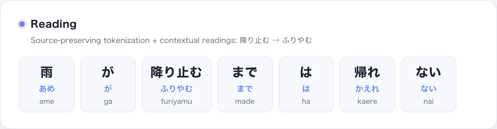
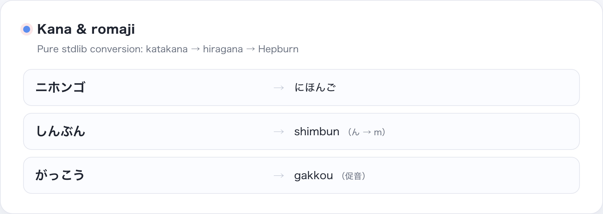
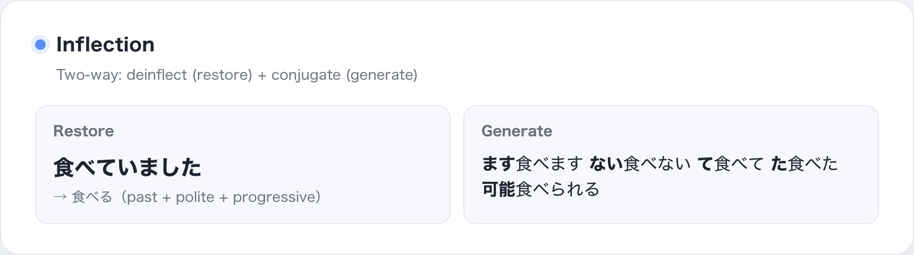
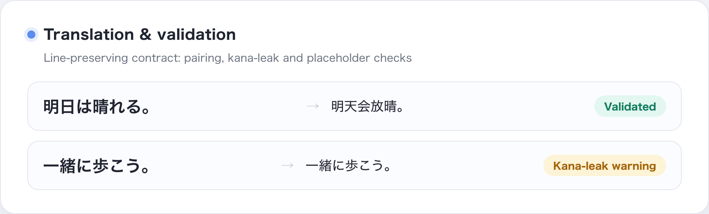
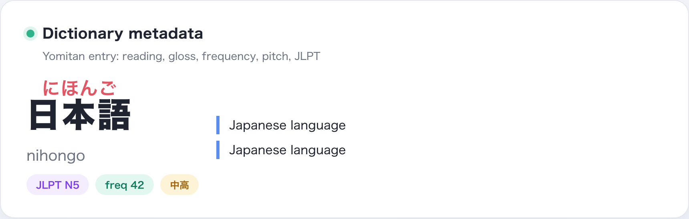
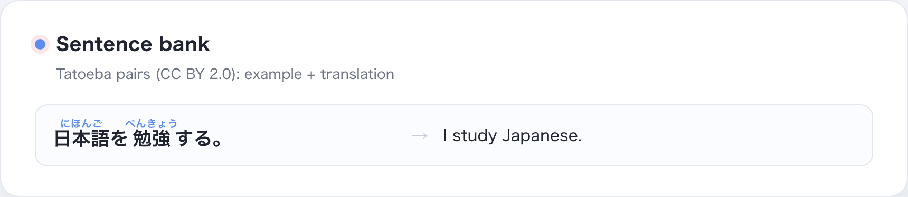
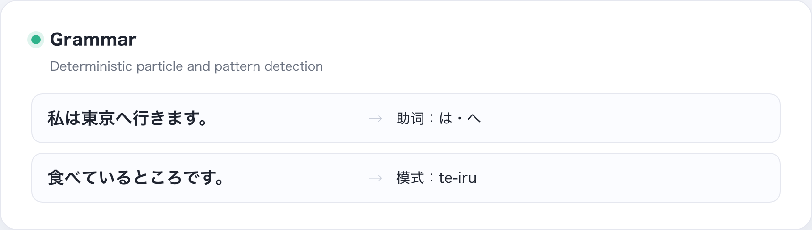
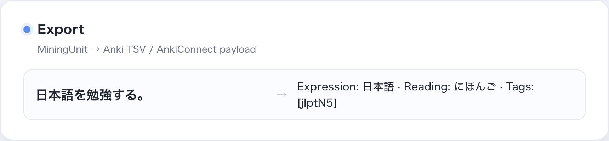
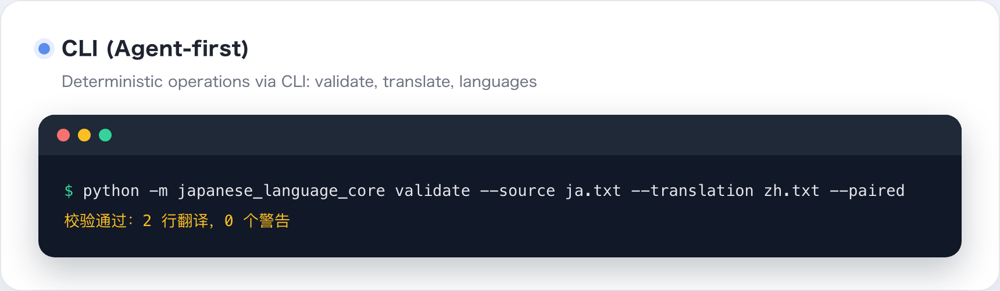

# Nihongo Core

**[English](README.md) · [简体中文](README.zh-CN.md) · [日本語](README.ja.md)**

A reusable Python library for Japanese reading and language-data contracts. Nihongo Core gives applications contextual readings, kana and romaji conversion, translation validation, dictionary readers, grammar checks, and export models.

It is a library, not a lyric search service, end-user app, or Agent workflow. Calling applications decide what to fetch, how to present results, which translation service to use, and which licensed datasets to provide.

## Capabilities and maturity

| Area | What it provides | Status and limit |
| --- | --- | --- |
| Reading | Contextual tokens, hiragana, Hepburn, reading alignment, kana utilities, deinflection, conjugation, sentence splitting, mora counts | Public API used by applications. Tests check contracts and source preservation, not human reading accuracy. |
| Translation | Line-based data model, validator, language registry, glossary checks, optional OpenAI-compatible client | Public contract. Structural checks cannot prove semantic quality. You supply the model endpoint and key. |
| Reference data | Yomitan terms and kanji, JMnedict names, pitch accent, difficulty scoring, KanjiVG, Tatoeba sentences | Readers and data adapters; most are experimental. Supply datasets and follow their licenses. |
| Composition | Particle and pattern checks, Anki payloads, paired Markdown, sentence-mining contracts | Experimental building blocks; user flows and network calls belong to the application. |

The repository does not bundle large dictionary or sentence archives. See [benchmark notes](docs/benchmarks.md) and the [reading review sheet](docs/reading-review-sheet.md) for the current evaluation limits and review status.

## Install

Python 3.10+. The base package has no runtime dependencies.

| Install | Includes |
| --- | --- |
| <code>japanese-language-core[reading]</code> | SudachiPy and SudachiDict Core for contextual reading |
| <code>japanese-language-core[translation]</code> | Translation contracts and validator; standard library only |
| <code>japanese-language-core[all]</code> | The default reading dependencies |
| <code>japanese-language-core[pykakasi]</code> | Optional comparison engine; its Fugashi/PyKakasi dependency chain includes GPL-3.0 |

~~~bash
python3 -m venv .venv
source .venv/bin/activate

# Reading API
python -m pip install "japanese-language-core[reading] @ git+https://github.com/qweihu/japanese-language-core.git@v0.4.0"

# Or translation contracts only
python -m pip install "japanese-language-core[translation] @ git+https://github.com/qweihu/japanese-language-core.git@v0.4.0"
~~~

For local development:

~~~bash
git clone https://github.com/qweihu/japanese-language-core.git
cd japanese-language-core
python3 -m pip install -e ".[reading]"
~~~

## Quick start: readings

~~~python
from japanese_language_core.reading import create_engine

engine = create_engine("auto")
tokens = tuple(engine.tokens("雨が降り止むまでは帰れない"))

for token in tokens:
    print(token.orig, token.hira, token.hepburn)

assert "".join(token.orig for token in tokens) == "雨が降り止むまでは帰れない"
~~~

The tokens preserve the exact source while adding readings: <code>雨 → あめ</code>,
<code>降り止む → ふりやむ</code>, <code>帰れ → かえれ</code>. Whitespace and line endings are
preserved too.

 Reading example · source segments reconstruct the input while each reading stays attached.

## Reading details

- <code>create_engine("auto")</code> prefers Sudachi. It falls back to the optional PyKakasi path only when that extra is installed; otherwise an unavailable reading engine raises an error.
- <code>ReadingToken.orig</code> pieces reconstruct the input exactly. <code>hira</code> and <code>hepburn</code> contain the reading; the Sudachi path can also expose morphological metadata.
- Kana conversion and Hepburn romanization are available without the reading extra.

 Kana conversion · the same text shown in both scripts and romaji.

 Inflection example · a verb form is analyzed and common forms are generated.

Reading output is not a guarantee that every name, lyric, dialect, or ambiguous kanji reading is correct. The current review sheet is a small process check, not an accuracy score or a human-reviewed benchmark.

## Translation contracts

Core does not provide a translation model. It can send line-based units to an OpenAI-compatible endpoint you configure, or let an Agent supply translations to the same data contract.

The validator can check:

- one-to-one non-empty line pairing when <code>paired=True</code>;
- Ruby markup and source reconstruction;
- preservation of placeholders such as <code>♪</code>, <code>[Chorus]</code>, and bracketed notes;
- Japanese kana left in a translated line;
- optional glossary consistency.

Line-count and structure failures are errors. Kana leakage is a warning unless strict warnings are requested. Passing validation means the shape is consistent; it does not mean the translation is accurate, natural, or faithful to the song.

 Validation example · structure passes while untranslated Japanese is flagged.

To use the optional client, supply the endpoint, model, and key in your application. Core does not ship credentials or choose the target language for callers.

## Reference and experimental modules

These modules are reusable parts, not turnkey products. Dataset access, licensing, caching, user interfaces, and product decisions stay with the consuming application.

### Dictionary and sentence readers

Yomitan dictionary readers can expose readings, definitions, tags, frequency, pitch-accent and JLPT metadata. JMnedict supports name lookups; KanjiVG readers expose stroke-order data. The sentence reader handles Tatoeba pairs; the dataset is separately supplied and licensed CC BY 2.0.

 Dictionary reader · entry fields are read from data supplied by the caller.

 Sentence reader · one source sentence stays paired with its supplied translation.

### Grammar and export

Grammar helpers perform deterministic particle and pattern checks; they are not a complete grammar parser. Export models can build Anki TSV or AnkiConnect payloads and paired Markdown, but do not perform Anki network actions or manage a learner's collection.

 Grammar checks · individual patterns are reported without claiming full parsing.

 Export payload · a concrete row is ready for the calling application.

## Command line

The <code>nihongo</code> command and <code>python -m japanese_language_core</code> expose deterministic operations. Translation validation and translation helpers also have their own module entry point.

~~~bash
nihongo --help
python -m japanese_language_core.translation validate \
  --source source.txt --translation translation.txt --paired
python -m japanese_language_core.translation languages
~~~

 CLI output · validation returns a pass result and a warning count.

## Development and evaluation

~~~bash
python3 -m pip install -e ".[all]"
python3 -m pytest -q
~~~

The test suite checks API contracts, serialization, source preservation, and deterministic behavior. It does not establish reading accuracy or translation quality. If you publish benchmark claims, use a human-reviewed dataset and document the engine and dictionary versions.

## License

MIT. Optional dependencies and external datasets may have different licenses; review their terms before redistribution.
