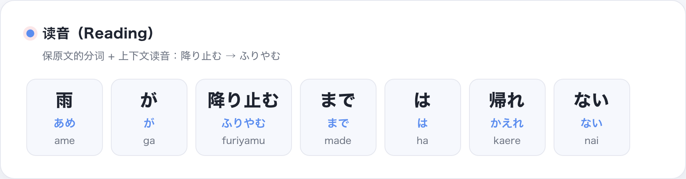
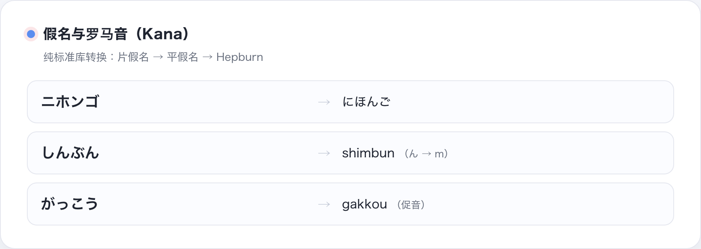
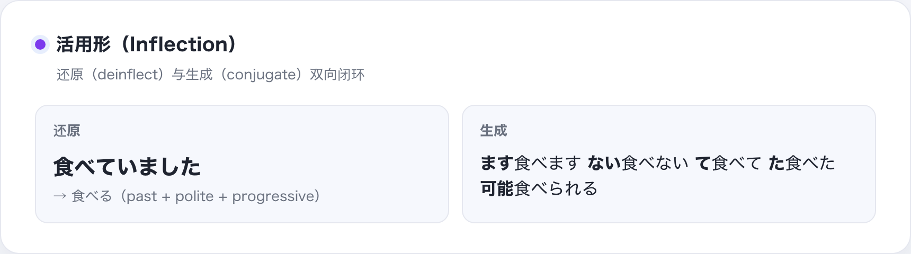
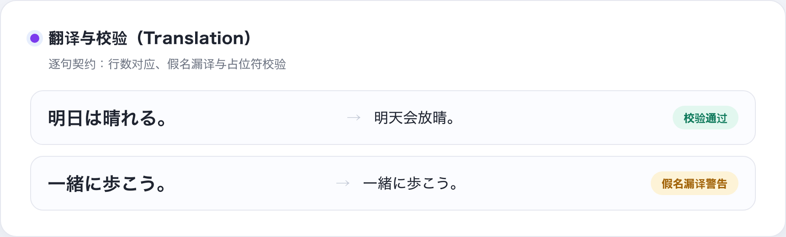
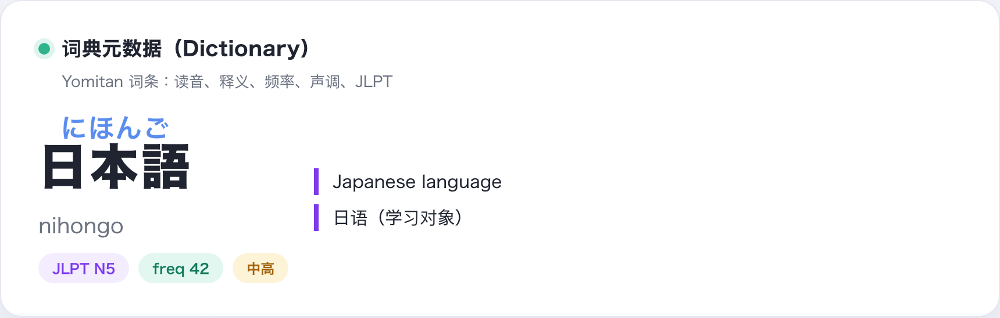
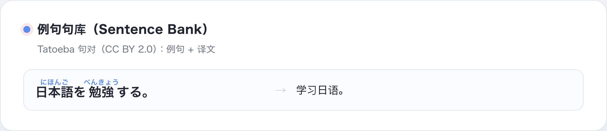
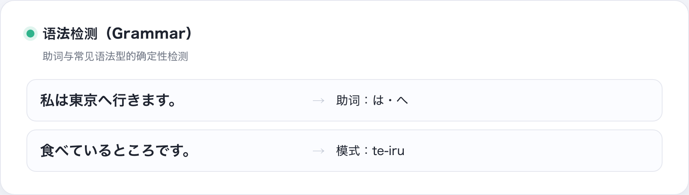
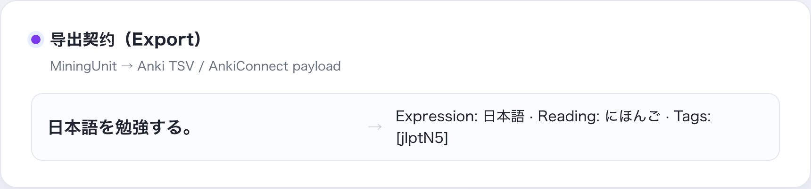
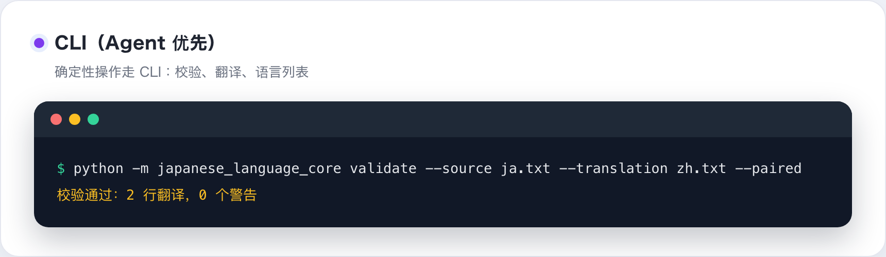
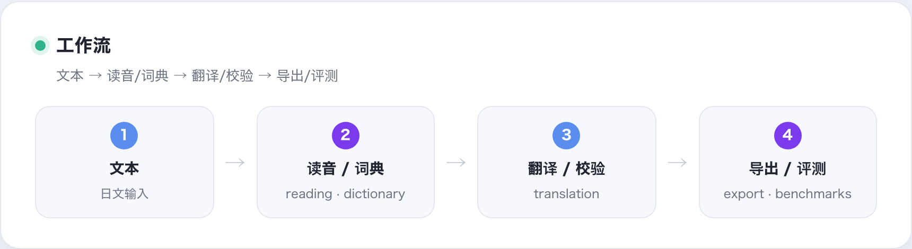

# Nihongo Core（japanese-language-core）

**[English](README.md) | [简体中文](README.zh-CN.md) | [日本語](README.ja.md)**

Nihongo Core 是一个面向 Python 的专业日语语言处理库：上下文读音、假名与罗马音、
读音-汉字对齐、活用形还原、逐句翻译契约、词典元数据、语法型检测与导出契约。

它围绕两个理念构建：

- **确定性契约**：核心行为是小型、可测试、可版本化的接口——读音 token、
  翻译单元、词典词条——你可以放心在其上构建工具。
- **可选重依赖**：基础包零依赖。读音需要形态学词典；翻译是 LLM 能力，
  端点由你提供；其余一切保持轻量。

---

## 功能总览

| 模块名称 | 名称 | 内容 |
| --- | --- | --- |
| [`japanese_language_core.reading`](#读音reading) | 读音 | 保原文分词 + 上下文读音（`auto` / `sudachi` / `pykakasi`） |
| [`japanese_language_core.reading.kana`](#假名与罗马音) | 假名与罗马音 | 假名转换、全半角归一、Hepburn 罗马音 |
| [`japanese_language_core.reading.alignment`](#读音-汉字对齐) | 读音-汉字对齐 | 读音分配到汉字（ruby 渲染） |
| [`japanese_language_core.reading.deinflect`](#活用形还原) | 活用形还原 | 变形 → 辞書形 候选 |
| [`japanese_language_core.reading.conjugator`](#活用形还原) | 活用形生成 | 辞書形 → 常用活用形生成 |
| [`japanese_language_core.reading.splitter`](#读音reading) | 句子分割 | 句子分割（保留句末符号） |
| [`japanese_language_core.reading.mora`](#读音reading) | 拍计数 | 拍（mora）计数 |
| [`japanese_language_core.translation`](#翻译translation) | 翻译 | 逐句契约、校验、语言注册表、术语一致性 |
| [`japanese_language_core.translation.provider`](#byo-llm-翻译) | 翻译执行器 | Agent 模式（无 API）或 BYO-LLM（任意 OpenAI 兼容端点） |
| [`japanese_language_core.dictionary`](#词典dictionary) | 词典 | Yomitan 词典读取 + JLPT 难度分析 |
| [`japanese_language_core.dictionary.jmnedict`](#专名jmnedict) | 专名（JMnedict） | 专名查询：读音与类别 |
| [`japanese_language_core.dictionary.pitch`](#搜索声调难度打分与笔顺) | 声调 | 声调位置 → H/L 升降模式与分类 |
| [`japanese_language_core.dictionary.scoring`](#搜索声调难度打分与笔顺) | 难度打分 | 可读性 / 难度打分 |
| [`japanese_language_core.dictionary.kanjivg`](#搜索声调难度打分与笔顺) | 笔顺（KanjiVG） | 笔顺与部首读取器（数据自备） |
| [`japanese_language_core.grammar`](#语法grammar) | 语法 | 助词与常见语法型检测 |
| [`japanese_language_core.export`](#导出export) | 导出 | Anki 笔记契约与中日对照 Markdown |
| [`japanese_language_core.export.mining`](#闪卡挖掘mining) | 挖句流水线 | Anki 挖句流水线契约（句 → 笔记 → payload） |
| [`japanese_language_core.sentences`](#例句句库sentences) | 例句句库 | Tatoeba 句库读取器（数据 CC BY 2.0） |

> **能力成熟度**：`reading` 与 `translation` 是生产级核心；`dictionary`、
> `grammar`、`export` 是稳定但实验性的能力——接口有测试，但目前没有内置
> 消费方依赖它们，请按需使用。

<p align="center">
  
  <br><sub>保原文的分词与上下文读音</sub>
</p>

## 安装

需要 Python 3.10+。

### 虚拟环境（推荐）

始终在虚拟环境里安装，避免污染系统 Python。还没有虚拟环境时先创建：

```bash
python3 -m venv .venv          # 创建环境
source .venv/bin/activate      # macOS/Linux；Windows: .venv\Scripts\activate
```

然后在已激活的环境中执行下面的安装命令。

### Python 与 python3 命令兼容

本库需要 Python 3.10+。在 macOS 和多数 Linux 上，裸 `python` 命令可能不存在
或指向 Python 2，虚拟环境外请使用 `python3`。在已激活的虚拟环境内
`python` 与 `python3` 都可用；未激活时请显式调用解释器，例如
`.venv/bin/python -m japanese_language_core ...`。

安装后也可以直接使用 `nihongo` 命令（位于虚拟环境的 `bin` 目录），
各平台行为一致，不区分 `python`/`python3`。

```bash
# 仅读音（Sudachi / Fugashi / PyKakasi）
python3 -m pip install "japanese-language-core[reading] @ git+https://github.com/qweihu/japanese-language-core.git@v0.2.0"

# 仅翻译（纯标准库，零依赖）
python3 -m pip install "japanese-language-core[translation] @ git+https://github.com/qweihu/japanese-language-core.git@v0.2.0"

# 全部
python3 -m pip install "japanese-language-core[all] @ git+https://github.com/qweihu/japanese-language-core.git@v0.2.0"
```

本地开发：

```bash
git clone https://github.com/qweihu/japanese-language-core.git
cd japanese-language-core
python3 -m pip install -e ".[reading]"
```

顶层包不 import 任何重模块；重适配器在 `reading` 子模块内延迟加载，
纯翻译安装保持零依赖。

## 快速上手

### 1. 给一句话加读音

```python
from japanese_language_core.reading import create_engine

engine = create_engine("auto")
tokens = tuple(engine.tokens("雨が降り止むまでは帰れない"))
for token in tokens:
    print(token.orig, token.hira, token.hepburn)
```

输入 `雨が降り止むまでは帰れない`，输出读音
`あめ / が / ふりやむ / まで / は / かえれ / ない`
（Hepburn：`ame / ga / furiyamu / made / ha / kaere / nai`）。

```python
assert "".join(token.orig for token in tokens) == "雨が降り止むまでは帰れない"
```

### 2. 校验逐句翻译

```bash
python3 -m japanese_language_core.translation validate \
  --source source.txt --translation translation.txt --paired
```

`source.txt`：

```text
明日は晴れる。
一緒に歩こう。
```

`translation.txt`：

```text
明天会放晴。
一起走吧。
```

两行一一对应时校验通过；警告与报错情形详见下方「结构校验」。

### 3. 用自带 LLM 端点翻译

```python
from japanese_language_core.translation import (
    OpenAICompatibleTranslator, TranslationUnit,
)

translator = OpenAICompatibleTranslator(
    base_url="http://localhost:11434/v1", model="llama3.1",
)
result = translator.translate(
    [TranslationUnit("明日は晴れる。"), TranslationUnit("一緒に歩こう。")],
    target_lang="zh-CN",
)
for unit in result.units:
    print(unit.source, "→", unit.translation)
```

```text
明日は晴れる。 → 明天会放晴。
一緒に歩こう。 → 一起走吧。
```

## 读音（reading）

`create_engine` 返回 `ReadingEngine`，其 `tokens(text)` 产出
`ReadingToken(orig, hira, hepburn)` 片段；`orig` 拼接后永远还原输入，
包括空白与换行。

```python
from japanese_language_core.reading import ReadingToken

token = ReadingToken("降り止む", "ふりやむ", "furiyamu")
```

Sudachi 引擎下每个 token 还携带形态学元数据（PyKakasi 路径下为空）：

| 字段 | 含义 |
| --- | --- |
| `part_of_speech` | 斜杠分隔的词性标签（如 `名詞/普通名詞/一般`） |
| `dictionary_form` | 辞書形 |
| `normalized_form` | Sudachi 标准形 |

### 引擎模式

| 模式 | 行为 | 适用 |
| --- | --- | --- |
| `auto` | 优先 Sudachi，不可用时回退 PyKakasi | 常规使用 |
| `sudachi` | 强制 Sudachi + 词典 | 严格生产/CI |
| `pykakasi` | Fugashi/PyKakasi 路径 | 兼容与对比 |

严格模式在引擎不可用时抛 `EngineUnavailableError`，不会静默换引擎。
`ReadingEngine` 是唯一公共边界；你不接触 Sudachi `Morpheme`、Fugashi tag
对象或词典内部结构。

`auto` 模式下实际使用的引擎可通过 `engine.name` 读取（含降级后）；需要严格
一致时用 `--engine sudachi` / `--engine pykakasi`。CLI 可用
`reading --verbose` 打印引擎名。

<p align="center"></p>

## 假名与罗马音

纯标准库工具：

```python
from japanese_language_core.reading import (
    to_hiragana, to_katakana, to_romaji, is_kana, is_kanji,
)

print(to_hiragana("ニホンゴ"))   # → にほんご
print(to_katakana("にほんご"))   # → ニホンゴ
print(to_hiragana("ﾆﾎﾝｺﾞ"))     # → にほんご  （半角 + 浊音符号）
print(to_romaji("しんぶん"))     # → shimbun   （Hepburn：ん 在 b/m/p 前读 m）
print(to_romaji("がっこう"))     # → gakkou    （促音双写）
```

罗马音转换器是务实的 Hepburn 实现；生产级罗马音建议使用引擎的
`hepburn` 字段（需 `[reading]` 扩展）。

<p align="center"></p>

## 读音-汉字对齐

`align_reading(term, reading)` 把假名读音分配到汉字——ruby 渲染背后的分布问题：

```python
from japanese_language_core.reading import align_reading

print(align_reading("食べる", "たべる"))
```

```text
[('食', 'た'), ('べ', 'べ'), ('る', 'る')]
```

```python
print(align_reading("日本語", "にほんご"))
```

```text
[('日本語', 'にほんご')]
```

词中假名逐字匹配；每段汉字贪婪消费假名，直到遇到下一个假名或读完。
歧义复合词（好き嫌い）可能需要词典级对齐，`dictionary` 能力可提供线索；
该函数是确定性回退。贪心选择是合法但未必与社区词典一致的分布
（如 好き嫌い → 好=す、き=き、嫌=きら）；需要与词典一致时请使用带读音
分布的词典数据（读取器支持词条内 `furigana` 扩展字段）。已知限制。

## 活用形还原

`deinflect(word)` 返回辞書形候选及产生它的规则链：

```python
from japanese_language_core.reading import deinflect

for candidate in deinflect("食べていました"):
    print(candidate.word, "|", candidate.reason)
```

```text
食べる | past + polite + progressive
```

（完整结果还包含中间形态，如 `食べている | polite past`。）规则引擎剥离常见
后缀——ます/ない/た/て/ている/すぎる/やすい 等——结尾有歧义时输出多个候选
（行った → 行く/行つ/行る/行う）。有词典数据时用 `dictionary.lookup_terms`
过滤候选。

<p align="center"></p>

## 翻译（translation）

翻译是 LLM 能力。库提供契约、校验、语言注册表与执行器——不内置模型、
不打包密钥。

### 数据模型

```python
from japanese_language_core.translation import TranslationUnit, TranslationResult

unit = TranslationUnit("明日は晴れる。", "明天会放晴。")
result = TranslationResult(
    source_lang="ja", target_lang="zh-CN",
    units=[unit], provider="agent",
)
print(result.ok)  # True
```

### 结构校验

```python
from japanese_language_core.translation import validate_translation

errors, warnings = validate_translation(
    source_lines=["明日は晴れる。", "一緒に歩こう。"],
    translation_lines=["明天会放晴。", "一起走吧。"],
    paired=True,
)
print(errors)    # []
print(warnings)  # []
```

检查项：

- 行数配对（非空行数一致、空行分组保留）；
- ruby/HTML 卫生（标签闭合、只允许 `ruby`/`rt`）；
- 原文保真（剥离 ruby 后还原原文）；
- 占位符保留（`♪`、`[Chorus]`、`（…）`、`【…】`）；
- 假名漏译（翻译行残留平假名/片假名）；
- 术语一致性（可选）。

CLI（命令见快速上手与 CLI 参考）：

| 情况 | 结论 |
| --- | --- |
| 行数一一对应、无残留假名 | 校验通过，退出码 0 |
| 翻译行残留假名（漏译） | 警告；`--strict-warnings` 下退出码 3 |
| 行数不匹配或结构错误 | 错误，退出码 1 |

<p align="center"></p>

### 语言注册表

```bash
python3 -m japanese_language_core.translation languages
```

```text
en: English
zh-CN: 简体中文（默认）
```

```python
from japanese_language_core.translation import LanguageRegistry

registry = LanguageRegistry.from_package()
print(registry.default().code)  # zh-CN
print(registry.codes())         # ['en', 'zh-CN']
```

机器可读注册表（`translation/data/languages.json`）驱动 BYO-LLM prompt；
新增语言 = 注册 + （可选）为 Agent 补充人读约定。

### 术语一致性

```python
from japanese_language_core.translation import TermGlossary, GlossaryEntry

glossary = TermGlossary()
glossary.add(GlossaryEntry(source="明日", preferred="明天"))

errors, warnings = validate_translation(
    ["明日は晴れる。"], ["明天会放晴。"], paired=True, glossary=glossary,
)
print(warnings)  # []
```

当源词未翻译、未使用首选译文、或同一词在不同行译文不一致时告警。

## BYO-LLM 翻译

自带 OpenAI 兼容端点——Ollama、vLLM、LM Studio、网关均可。配置 `base_url`
（客户端自动追加 `/chat/completions`）、`model`、可选 `api_key`（或环境变量
`JAPANESE_LANGUAGE_CORE_API_KEY`）、`temperature`、`max_tokens`，以及
`max_retries` / `retry_backoff` / `max_chars_per_request`。
可运行示例见快速上手 #3。

CLI：

```bash
export JAPANESE_LANGUAGE_CORE_API_KEY=sk-...
python3 -m japanese_language_core.translation translate \
  --source source.txt --target-lang zh-CN \
  --base-url https://api.example.com/v1 --model my-model
```

执行过程：

1. 用注册语言的约定自动构建 system prompt；
2. 语言注册表中的 few-shot 示例稳定风格与输出形态；
3. 长输入自动分批（`max_chars_per_request`，默认 4000），失败自动重试
   （`max_retries`、`retry_backoff`）；
4. 模型输出按源行数解析回逐行翻译；行数不足抛 `TranslateError`——
   不会静默截断；
5. 结果走同一套 `validate_translation` 校验。

测试时可注入 `transport` 可调用对象（默认是标准库 `urllib` 实现）：

```python
def fake_transport(url, headers, payload):
    return '{"choices": [{"message": {"content": "1. 明天会放晴。"}}]}'

translator = OpenAICompatibleTranslator(
    base_url="https://example.test/v1", model="test",
    transport=fake_transport,
)
```

## 词典（dictionary）

词典读取器消费开放的 **Yomitan 格式**（zip 包）——社区日语词典的事实标准
（JMdict 系、频率、声调、JLPT 标签等）。最小 `term_bank_1.json`：

```json
[
  ["日本語", "にほんご", ["language"], [], 0, ["Japanese language"], 100, ["jlptN5"]],
  ["勉強", "べんきょう", ["n", "vs"], [], 0, ["study"], 101, ["jlptN5"]]
]
```

```python
from japanese_language_core.dictionary import YomitanDictionary

dictionary = YomitanDictionary("JMdict.zip")
term = dictionary.lookup_terms("日本語")[0]
print(term.reading, term.definitions, term.tags, term.frequency)
```

```text
にほんご ['Japanese language'] ['language', 'jlptN5'] None
```

汉字 bank 查询：

```python
kanji = dictionary.lookup_kanji("日")[0]
print(kanji.onyomi, kanji.kunyomi, kanji.meanings)
```

```text
['ニチ', 'ジツ'] ['ひ'] ['day', 'sun']
```

支持的 bank：

| Bank | 内容 |
| --- | --- |
| `term_bank_*.json` | 词条、读音、释义、标签、规则、score、sequence |
| `term_meta_bank_*.json` | 频率（`freq`）与声调（`pitch`） |
| `kanji_bank_*.json` | 音读/训读、释义、标签、统计 |
| `kanji_meta_bank_*.json` | 汉字频率 |
| `tag_bank_*.json` | 标签定义（词性、等级、分类） |
| `index.json` | 词典元数据 |

社区词典对频率/声调数据的编码存在几种常见变体，读取器均已覆盖：频率可为
整数或含 `value`/`frequency` 键的 dict；声调可为 `{position, category}`
列表、整数位置或 `"n/a"`（跳过）。

### JLPT 难度分析

```python
from japanese_language_core.dictionary import analyze_difficulty

profile = analyze_difficulty("日本語を勉強する。", dictionary)
print(profile.level_counts(), profile.unknown, profile.score)
```

```text
{'n5': 3, 'unknown': 2} ['を', '。'] 5.0
```

传入读音引擎可用形态学分词替代最长匹配回退：

```python
from japanese_language_core.reading import create_engine

profile = analyze_difficulty("日本語を勉強する。", dictionary, engine=create_engine("auto"))
```

<p align="center"></p>

### 专名（JMnedict）

```python
names = dictionary.lookup_names("山田")
print(names[0].readings, names[0].categories)
```

```text
('やまだ',) ['surname']
```

`NameEntry` 携带读音、类别（姓氏/名字/地名/组织/…）与可选释义；
兼容 JMnedict 的"读音列为空、释义槽放假名读音"格式。

### 搜索、声调、难度打分与笔顺

```python
from japanese_language_core.dictionary import (
    classify, KanjiVGReader, pattern, readability,
)

dictionary.search("日本", "prefix")       # prefix / substring / wildcard
pattern(4, 2)                             # ('H', 'H', 'L', 'L') → 中高
classify(4, 2)                            # "中高 nakadaka"
readability(profile)                      # 0..1，越大越简单
KanjiVGReader("path/to/kanjivg").lookup("日")  # 笔顺与部首（数据自备）
```

### 例句句库（sentences）

```python
from japanese_language_core.sentences import SentenceBank

bank = SentenceBank.from_tatoeba("jpn_sentences.tsv", "jpn-cmn_links.tsv")
examples = bank.lookup("日本語")
for sentence in examples:
    print(sentence.text, "→", [t.text for t in bank.translations(sentence.id)])
```

读取 Tatoeba 句表与链接导出（CC BY 2.0）；下载与解压由调用方负责。

<p align="center"></p>

## 语法（grammar）

确定性的表层检测——快速可测，不替代形态学分析：

```python
from japanese_language_core.grammar import find_particles, find_grammar

print([m.particle for m in find_particles("私は東京へ行きます。")])
```

```text
['は', 'へ']
```

```python
print([(m.name, m.matched) for m in find_grammar("食べているところです。")])
```

```text
[('te-iru', 'ている')]
```

助词检测识别"是已知助词或以助词结尾"的假名串。语法型包括て形结构
（ている/ておく/てしまう/てもいい/てはいけない/てほしい）、义务
（なければならない/ないといけない）、可能（ことができる）、条件
（たら/れば）等。

<p align="center"></p>

## 导出（export）

### Anki 笔记

```python
from japanese_language_core.export import build_note, to_tsv
from japanese_language_core.translation import TranslationUnit

note = build_note(
    TranslationUnit("日本語を勉強する。", "学习日语。"),
    expression="日本語", reading="にほんご",
    glossary="Japanese language", tags=["jlptN5"],
)
print(to_tsv([note]), end="")
```

```text
Expression	Reading	Glossary	Sentence	Translation	Audio	Pitch	Frequency	Tags
日本語	にほんご	Japanese language	日本語を勉強する。	学习日语。				jlptN5
```

`anki_connect_payload(...)` 生成 AnkiConnect `addNote` 请求结构；
实际 API 调用留在你的应用层。

### 中日对照 Markdown

```python
from japanese_language_core.export import build_paired_markdown
from japanese_language_core.translation import TranslationUnit

markdown = build_paired_markdown([
    TranslationUnit("日本語を勉強する。", "学习日语。"),
    TranslationUnit("一緒に歩こう。", "一起走吧。"),
])
print(markdown, end="")
```

```text
日本語を勉強する。
学习日语。

一緒に歩こう。
一起走吧。
```

每单元"源行 + 紧跟的翻译行 + 组间空行"。

### 闪卡挖掘（mining）

`export.mining` 是挖句流水线契约：句 → 笔记 → AnkiConnect payload。

```python
from japanese_language_core.export import MiningUnit, mining_payload

unit = MiningUnit(
    sentence="日本語を勉強する。",
    translation="学习日语。",
    expression="日本語",
    reading="にほんご",
    tags=["jlptN5"],
)
payloads = mining_payload([unit], deck_name="Mining", model_name="Basic")
```

<p align="center"></p>

## CLI 参考

```text
python -m japanese_language_core.translation validate
    --source FILE | -       源日语文本
    --translation FILE | -  翻译文本
    --paired                要求非空行数一致
    --no-kana-warn          关闭假名漏译警告
    --glossary FILE         JSON 术语表（{"entries": [...]}）
    --strict-warnings       有警告时退出码 3

python -m japanese_language_core.translation translate
    --source FILE | -       源日语文本
    --target-lang CODE      默认 zh-CN
    --base-url URL          OpenAI 兼容端点
    --model NAME            模型标识
    --api-key KEY           可选；环境变量 JAPANESE_LANGUAGE_CORE_API_KEY
    --output FILE           写入翻译文件

python -m japanese_language_core.translation languages
    [--registry FILE]       列出已注册目标语言
```

<p align="center"></p>

## 工作流

文本 → 读音/词典 → 翻译/校验 → 导出/评测。各能力可组合成流水线，
每一步都保持小而可测的契约。

<p align="center"></p>

## 设计原则

- **能力按子模块按需引入**：顶层不 import 重模块，纯翻译安装零依赖；
- **契约小而可测**：`ReadingToken`、`TranslationUnit`、词典模型都是
  小接口 + 契约测试；
- **翻译是 LLM 能力**：库定义契约/约定/校验，执行者由你选择
  （Agent 或自带端点）；
- **词典是证据不是替代**：丰富与审计结果，不静默覆盖主引擎；
- **不包含产品层**：清洗、排版、UI、用户数据留在你的应用里。

## 边界（非目标）

本库明确不包含：

- 翻译引擎本体（翻译是 LLM 能力）；
- 歌词抓取或清洗工具；
- furigana/HTML 渲染器与语言检测器；
- 用户数据存储、云服务与 API 密钥；
- 词典数据分发（消费 Yomitan 格式，不打包词典归档）。

## 测试

```bash
python3 -m unittest discover -s tests -v
```

测试覆盖原文保真、上下文读音、假名/罗马音、读音对齐、活用形还原、
翻译校验、provider 传输、Yomitan 解析、JLPT 分析、语法检测与导出往返。

## Roadmap

- 扩充审核过的上下文读音用例；
- 通过现有 Yomitan 读取器接入社区频率/JLPT/声调词典；
- 术语表文件成为一等资产；
- 发布稳定版本与兼容性说明；
- 在独立维护的日语语料上度量读音准确率。

## 许可

MIT。本项目基于开源组件（Sudachi、Fugashi、PyKakasi、UniDic、Yomitan
词典格式）构建；各自许可证归各自项目所有。
